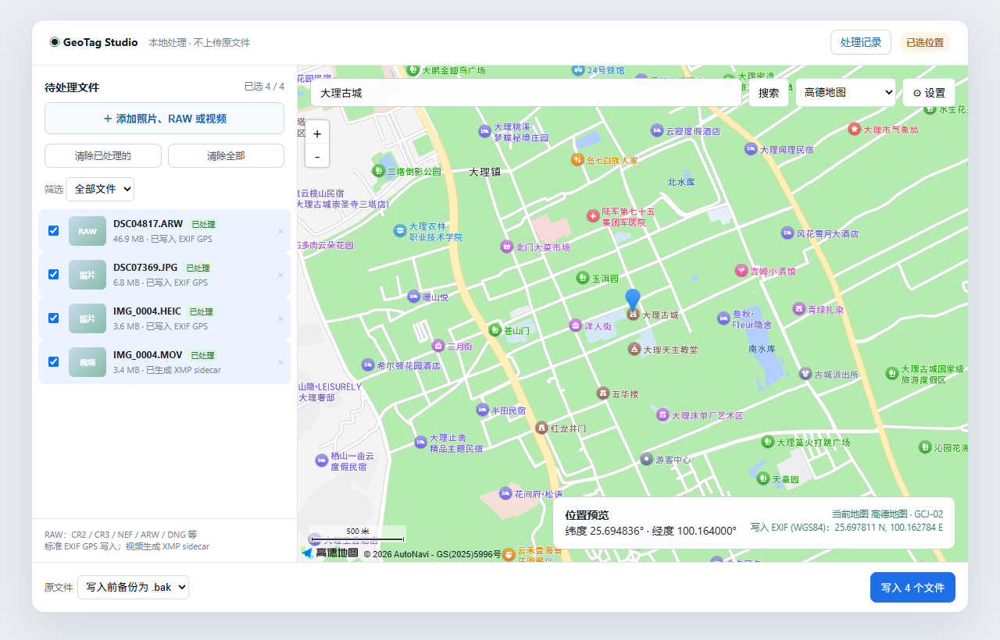
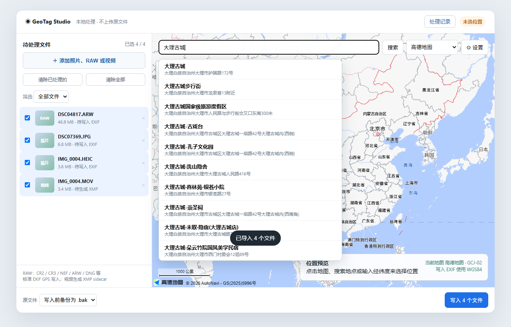
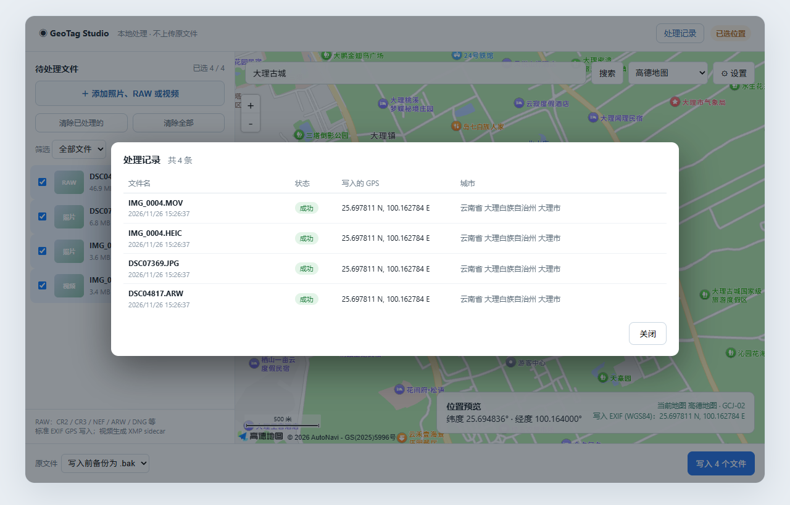

<div align="center">

# GeoTag Studio

**给照片、RAW 和视频批量写入 GPS 位置的 Windows 小工具**

绿色版 · 双击即用 · 照片不上传 · [GPL-3.0](LICENSE)

[下载](#下载与运行) · [三步上手](#三步上手) · [常见问题](#常见问题) · [从源码构建](docs/发布指南.md)

</div>



## 简介

旅途中拍了一堆照片和视频，回来想把拍摄地点补进文件里。GeoTag Studio 让你在地图上选一个点，一次写进一批文件。照片始终留在你自己的电脑上，不会被上传。

## 功能

- **批量写入**：一次给一批照片、RAW 或视频写入同一个位置
- **三种选点方式**：在地图上点选（图钉可以拖动微调）、搜索地点（比如“大理古城”）、直接输入经纬度
- **两种地图**：高德地图和 OpenStreetMap，可以手动切换（高德需要你自己申请一个 Key，见下文）
- **写入有保险**：默认先把原文件备份成 `.bak`（已有的备份不会被覆盖），写完再读回核对；失败的文件会写明原因
- **处理记录**：每个文件是成功还是失败、写入了哪个坐标、在哪个城市，重启后还能查
- **操作省事**：把文件或整个文件夹拖进来就能添加，写完的文件标“已处理”，一键清除
- **文件名不限**：中文、空格、表情符号都可以

支持的格式：

| 类型 | 格式 | 写入方式 |
| --- | --- | --- |
| 照片 | JPG、JPEG、PNG、HEIC、TIFF | 写入 EXIF GPS |
| RAW | CR2、CR3、NEF、ARW、DNG、RAF、ORF、RW2、PEF、SRW | 写入 EXIF GPS，不解码、不重新编码 |
| 视频 | MP4、MOV、M4V、MKV | 在旁边生成同名 `.xmp` 文件，原视频不动 |

RAW 和照片的写入由 [ExifTool](https://exiftool.org/) 完成，压缩包里已经自带，不需要另外下载。

## 下载与运行

1. 打开 [Releases 页面](https://github.com/wumiann/geotag-studio/releases/latest)，下载 `GeoTagStudio-<版本号>-win-x64.zip`
2. 把压缩包**完整解压**到一个普通文件夹，比如 `D:\Tools\GeoTagStudio`
3. 双击 `GeoTagStudio.exe`

几点说明：

- 适用于 64 位的 Windows 10 和 Windows 11。地图需要联网。
- 不要在压缩包里直接运行，也不要放进 `C:\Program Files` 这类受保护的目录：程序需要在旁边生成 `data` 文件夹。
- 压缩包里已经带了 ExifTool 和运行库，不需要再安装别的东西。
- 程序依赖 WebView2 运行时，Windows 11 和保持更新的 Windows 10 都自带。如果启动时提示缺少它，到[微软官网](https://developer.microsoft.com/microsoft-edge/webview2/)下载“Evergreen 独立安装程序”装上即可。

## 三步上手

1. **添加文件**：点“添加照片、RAW 或视频”，或者把文件（也可以是装着它们的文件夹）拖到左侧的“待处理文件”区。
2. **选位置**，三种方式任选：
   - 在地图上点一下，图钉可以拖动微调
   - 在搜索框里输入地名，按回车或点“搜索”，在结果里点一条
   - 在搜索框里输入 `纬度,经度`
3. **写入**：点右下角的“写入 N 个文件”，核对弹出的确认清单，点“确认写入”。

写入完成后，成功的文件名右边会出现绿色的“已处理”，失败的会显示红色的失败原因。点右上角的“处理记录”可以查看历次结果。

列表里的“×”“清除已处理的”“清除全部”只是把文件从列表里去掉，不会删除或改动任何文件。

## 界面一览

| 搜索地点 | 处理记录 |
| --- | --- |
|  |  |

## 配置高德地图

默认使用 OpenStreetMap，它在国内通常需要代理才能加载。推荐花几分钟配置高德地图：免费，但需要自己申请一个 Key。

1. 注册并登录[高德开放平台](https://console.amap.com/dev/key/app)
2. 在“应用管理 → 我的应用”里创建一个应用，再点“添加 Key”
3. 服务平台一定选 **Web端(JS API)**。选成“Web服务”的 Key 不能用来显示地图
4. 创建后页面上会显示 **Key** 和 **安全密钥**，把它们填进程序右上角的“⚙ 设置”里，点保存

说明：

- Key 和安全密钥只保存在你电脑上的 `data` 文件夹里，不会随程序分发给任何人
- 配额和使用条款以高德开放平台的说明为准
- 配好之后，地点搜索和处理记录里的“城市”也由高德提供

## 常见问题

**提示找不到 `exiftool.exe`，或者 `Could not find ...\perl5*.dll`**
压缩包没有完整解压。`exiftool.exe` 必须和 `exiftool_files` 文件夹放在一起。

**地图是空白的**
先检查网络。使用 OpenStreetMap 需要能访问 openstreetmap.org。高德地图加载失败时，地图上方会直接显示高德返回的错误码，多数情况下是 Key 的类型不对，或者安全密钥没填。

**搜索失败，或者提示连接搜索服务超时**
没有配置高德 Key 时，搜索使用 OpenStreetMap 的搜索服务，在国内同样需要代理。配好高德 Key 就会改用高德搜索。

**写入失败：Not a valid JPG**
文件本身已经损坏，或者扩展名和实际内容不符，与软件无关。

**多出来的 `.bak` 文件是什么**
写入前的原始文件备份。确认位置无误后可以手动删除；再次写入不会覆盖已有的 `.bak`。

**原文件会被修改吗**
照片和 RAW 会被修改，所以默认先备份。视频不会被修改，位置写在旁边的同名 `.xmp` 文件里。

**写错了怎么恢复**
把对应的 `.bak` 文件改回原来的文件名。

**为什么同一个点，换一种地图后坐标略有不同**
高德地图使用 GCJ-02 坐标系，OpenStreetMap 和照片的 EXIF 使用 WGS84，两者相差几百米到一公里。程序会在两种坐标系之间自动换算，写进文件的始终是 WGS84。详见[技术说明](docs/技术说明.md)。

**处理记录保存在哪里**
程序旁边的 `data\history.jsonl`。记录里有文件的完整路径，把 `data` 文件夹拷给别人之前先看一眼。

## 隐私与安全

- 照片和视频不会被上传，处理全部在本机完成
- 联网只用来加载地图、搜索地点和查询城市。请求发给高德或 OpenStreetMap，内容只有地名和坐标
- 高德 Key 和处理记录保存在程序旁边的 `data` 文件夹里
- 保持默认的“写入前备份为 .bak”，原文件就一定会留有一份

## 从源码构建

需要 Windows、Node.js、pnpm、Rust（MSVC 工具链）、Visual Studio Build Tools 2022（含 C++）和 WebView2。

```powershell
pnpm install
pnpm build
cargo +stable-x86_64-pc-windows-msvc build --manifest-path src-tauri/Cargo.toml --release --features tauri/custom-protocol
```

编译出来的程序还要和 ExifTool、VC++ 运行库放在一起才能使用，完整步骤见[发布指南](docs/发布指南.md)。

## 许可证

本项目的代码以 [GNU General Public License v3](LICENSE) 发布。

可执行程序压缩包里还带有 ExifTool、Strawberry Perl 运行库和 Microsoft Visual C++ 运行库等第三方组件，它们各自遵循自己的许可证，详见[第三方组件声明](THIRD-PARTY-NOTICES.md)。

## 更多文档

- [技术说明](docs/技术说明.md)：架构、写入流程、坐标系处理、已知的限制
- [发布指南](docs/发布指南.md)：从源码构建、绿色版目录结构、打包和发布

## 反馈

发现问题或有改进建议，欢迎提 [Issue](https://github.com/wumiann/geotag-studio/issues)。
